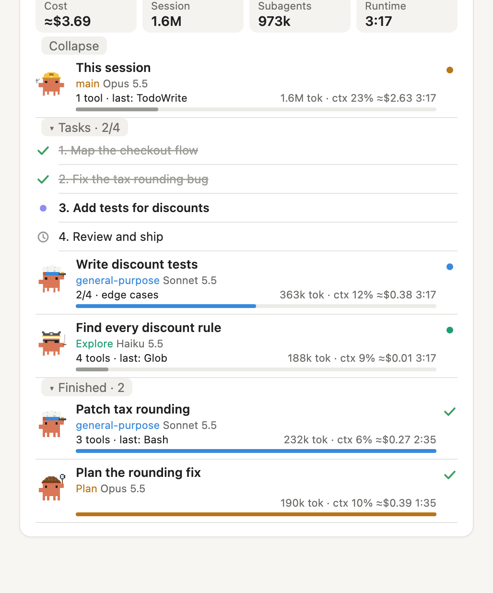
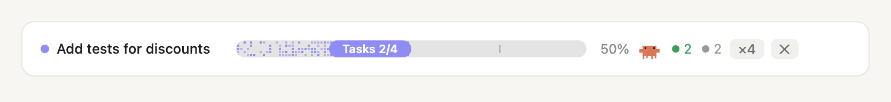

# claudeby-keyn

**English** · [Español](README.es.md) · [Português](README.pt.md)

Productivity and security skills and mods for [Claude Code](https://claude.com/claude-code). Each one solves a real problem of working with Claude every day: not knowing what your agents are doing, spending too much on simple work, or losing track of the session.

Everything here is one marketplace: add it once, then install only the plugins you want.

## Install

In a Claude Code terminal session, one line per plugin:

```
/plugin install agentes --marketplace KDomingos/claudeby-keyn
/plugin install delegate-tasks --marketplace KDomingos/claudeby-keyn
```

Answer `y` to add the marketplace the first time, then pick a scope (user scope makes it work in every project).

From a shell:

```bash
claude plugin install agentes --marketplace KDomingos/claudeby-keyn
claude plugin install delegate-tasks --marketplace KDomingos/claudeby-keyn
```

In the desktop app: click **+** next to the prompt box, then **Plugins**, **Add marketplace** with `KDomingos/claudeby-keyn`, then **Add plugin**.

Mods need a recent version of Claude Code.

## What's inside

| Plugin | Type | In one line |
|---|---|---|
| [agentes](#agentes) | Mod | A live panel with your session, its tasks and every subagent: tokens, cost and time |
| [delegate-tasks](#delegate-tasks) | Skill | Opus plans and reviews, Sonnet builds, Haiku does the quick simple work |

---

### agentes

A progress bar above the prompt and a live **Agents** panel beside the chat.





**What it shows**

- **This session:** model, effort, tools used, context fill, tokens, cost and runtime (only the time Claude was actually working).
- **Tasks:** the session's task list, live: done, in progress, pending.
- **Every subagent:** running and finished, each with its model, the tool it used last, its own steps if it reports them, tokens, context, cost and time. Each kind of agent gets its own pixel crab: a pirate for Explore, a detective for Plan, and a costume per model for the rest.
- **Totals:** cost of the whole session, session tokens, subagent tokens and runtime.
- **Progress bar:** the current task and how many are done, with running subagents in green and idle ones in grey. The `×N` button opens the panel; `✕` hides the bar.

The panel opens by itself the first time the session does something, once per session. `/agentes` shows or hides it.

**Why it matters.** Subagents work out of sight: you don't see which model each one uses, how long it takes or what it costs until the bill arrives. The panel makes that visible while it happens, so you can spot a runaway agent, an expensive model doing simple work, or a context about to fill up.

**Cost** is an estimate: the tokens Claude Code reports, priced at Claude API list prices (October 2026, in `PRICES` in `hooks/register.tsx`). With a subscription it is what the same work would cost on the API, not what you pay. The mod never calls the model, so it adds no cost of its own.

**Language:** the panel follows Claude Code's `language` setting (Spanish, English, Portuguese or Russian), or set it in `/config`.

Based on [savvy-progress](https://github.com/johnnyvizz/claude-kit) by johnnyvizz (MIT), reworked to follow the current session and any subagent without needing savvy-flow.

---

### delegate-tasks

A working method as a skill: the main model leads, and each task goes to the cheapest model that can do it well.

| Role | Model | Does |
|---|---|---|
| Lead | Opus | Analyzes, plans, writes short briefs, reviews what matters and verifies the result. Never writes code |
| Builder | Sonnet | All code and tests, even one-line fixes; simple reviews |
| Runner | Haiku | Reads, searches, extracts, simple mechanical checks |

It includes a three-question rule to pick the model, a brief template, and the guardrails that keep parallel subagents safe: one file per subagent, no git from subagents, and the lead runs the final checks itself. Before spawning a new subagent it reuses one that already worked on the same thing, so context isn't paid for twice. The split only changes when you say so explicitly, naming the model ("use only Opus").

**Why it matters.** Running everything on the strongest model is slow and expensive; running everything on a cheap one breaks things. Splitting by difficulty keeps quality where it matters, cuts cost on the routine work, and keeps the lead's context clean so it reviews better. It pairs well with **agentes**, which shows what each subagent costs.

Use it by asking Claude to "plan and delegate" or "delegate the tasks", or with `/delegate-tasks`.

---

## License

[MIT](LICENSE).
